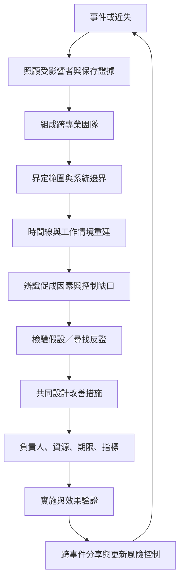

有效的事故調查是一個從受影響者支持、事實蒐集、事件重建、假設檢驗、系統分析到改善追蹤的循環。調查輸出應回到前線與組織治理，並能改變危害控制。

## 延伸連結
- 概念：[[Root_cause_analysis]]
- 概念：[[Near_miss]]
- 概念：[[Event_timeline]]
- 概念：[[Evidence_triangulation]]
- 概念：[[Just_culture]]
- 概念：[[Psychological_safety]]
- 概念：[[Organizational_learning]]
- 概念：[[Action_hierarchy]]
- 概念：[[Corrective_and_preventive_action]]
- 永久筆記：[[近失事件能揭示尚未造成傷害的系統弱點]]
- 永久筆記：[[患者與家屬是調查中的知識夥伴]]
- 永久筆記：[[根因分析必須以風險降低而非報告完成衡量]]

回到導讀：[[Root-cause_analysis]]
