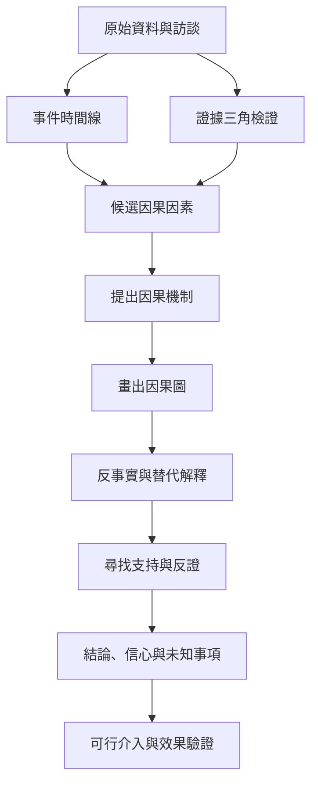

調查者需要區分觀察事實、推論與價值判斷。時間線提供事件脈絡，三角檢證檢查不同來源，因果機制說明箭頭如何運作，反事實問題則測試解釋力；每個結論都應保留不確定性。

## 延伸連結
- 概念：[[Causal_inference]]
- 概念：[[Causal_mechanism]]
- 概念：[[Counterfactual_reasoning]]
- 概念：[[Event_timeline]]
- 概念：[[Evidence_triangulation]]
- 概念：[[Contributing_factor]]
- 概念：[[Root_cause_analysis]]
- 永久筆記：[[因果敘事必須能追溯至可檢驗證據]]
- 永久筆記：[[相關性與因果性不同因此事故調查需要明確的因果機制]]
- 永久筆記：[[反事實問題有助於測試原因但不能取代資料]]

回到導讀：[[Root-cause_analysis]]
