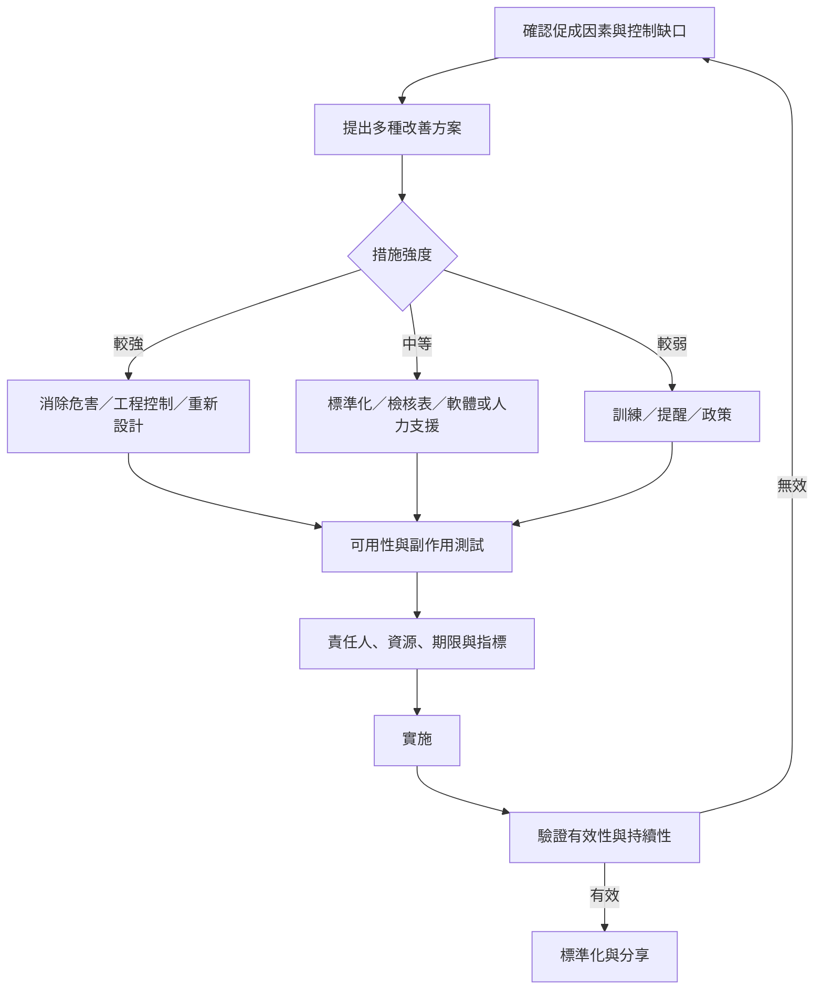

調查的價值要由改善結果證明。有效的措施應與促成因素有清楚對應，優先考慮消除危害、工程控制、流程簡化與標準化，並配置責任人、資源、期限與指標。

## 延伸連結
- 概念：[[Action_hierarchy]]
- 概念：[[Corrective_and_preventive_action]]
- 概念：[[PDCA]]
- 概念：[[A3_problem_solving]]
- 概念：[[FMEA]]
- 概念：[[Root_cause_analysis]]
- 永久筆記：[[強效改善措施應降低對記憶與警覺的依賴]]
- 永久筆記：[[改善工作必須嵌入日常管理而不是留在調查報告裡]]
- 永久筆記：[[根因分析必須以風險降低而非報告完成衡量]]

回到導讀：[[Root-cause_analysis]]
