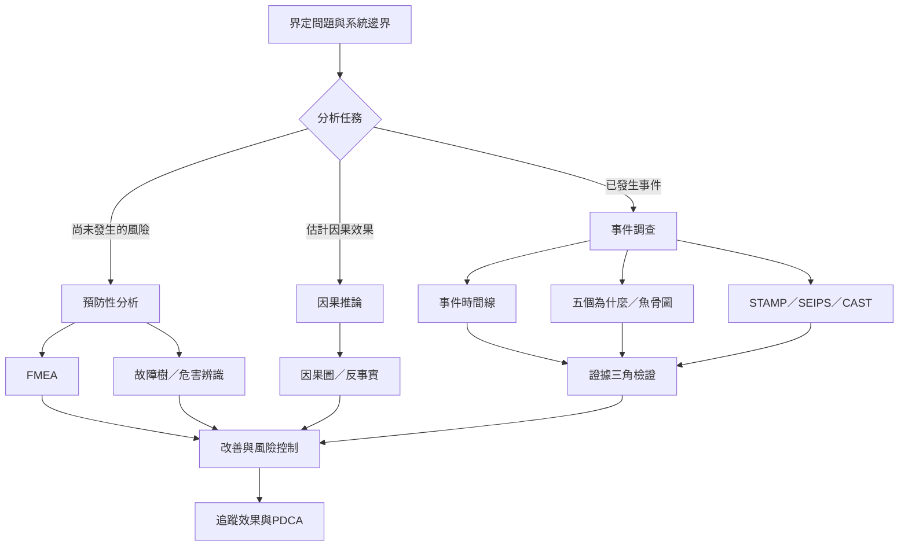

根因分析方法可依任務分成事後事件調查、預防性風險分析、因果推論與系統模型。工具不是彼此競爭的流派，而是對不同問題提供不同視角。先界定問題與系統邊界，再選擇能處理該類資料和複雜度的方法。

## 延伸連結
- 概念：[[Root_cause_analysis]]
- 概念：[[Five_whys]]
- 概念：[[Fishbone_diagram]]
- 概念：[[FMEA]]
- 概念：[[Fault_tree_analysis]]
- 概念：[[Causal_inference]]
- 概念：[[Counterfactual_reasoning]]
- 概念：[[STAMP]]
- 概念：[[SEIPS]]
- 概念：[[Evidence_triangulation]]
- 概念：[[PDCA]]
- 永久筆記：[[五個為什麼適合簡單流程追問但不宜強套複雜事故]]
- 永久筆記：[[魚骨圖用來擴展假設不能證明因果]]
- 永久筆記：[[工具應依問題選擇而非依習慣選擇]]

回到導讀：[[Root-cause_analysis]]
