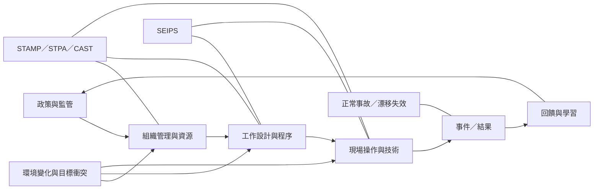

系統安全分析將注意力從孤立失誤轉向人、技術、任務、組織與監管之間的互動。當系統高度複雜、緊密耦合或持續變化時，應檢查控制約束、回饋與逐漸漂移的條件。

## 延伸連結
- 概念：[[Systems_thinking]]
- 概念：[[Socio_technical_system]]
- 概念：[[STAMP]]
- 概念：[[STPA]]
- 概念：[[CAST]]
- 概念：[[SEIPS]]
- 概念：[[Normal_accident_theory]]
- 概念：[[Latent_condition]]
- 概念：[[Work_as_done]]
- 概念：[[Work_as_imagined]]
- 永久筆記：[[單一事件鏈模型難以解釋複雜社會技術事故]]
- 永久筆記：[[安全文化應從實際決策和控制機制判斷]]
- 永久筆記：[[事故調查也要辨識系統如何成功與恢復]]

回到導讀：[[Root-cause_analysis]]
