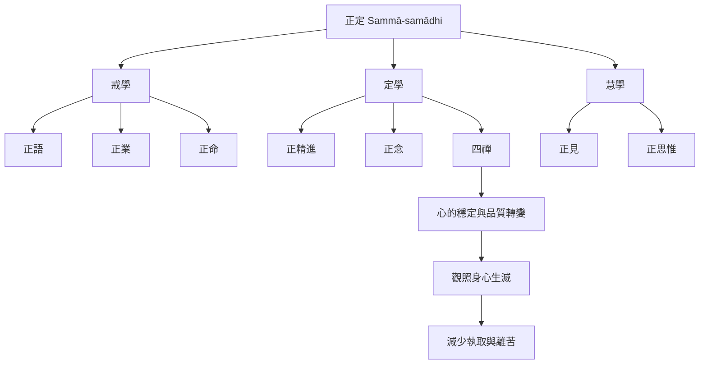

本圖以早期佛教的正定為中心，呈現戒、定、慧三學與八正道其他支分的支持關係。四禪是正定的重要經典描述，但定也服務於念與正知、知見及觀照五取蘊生滅等不同任務。

## 概念連結

* [[正定（Sammā-samādhi）]]
* [[三昧（Samādhi）]]
* [[禪那（Jhāna／Dhyāna）]]
* [[止（Samatha／Śamatha）]]
* [[觀（Vipassanā／Vipaśyanā）]]
* [[一境性（Ekaggatā）]]
