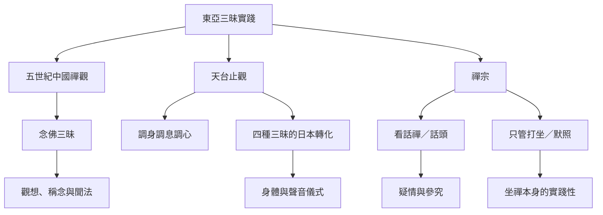

本圖聚焦中國與日本的三昧實踐：中國早期念佛三昧與智顗止觀、日本天台的四種三昧與儀式化實踐、曹洞宗只管打坐，以及臨濟系看話禪。它們呈現身體、聲音、觀想、話語和共同體如何成為定的實踐條件。

## 概念連結

* [[念佛三昧（Buddhānusmṛti-samādhi）]]
* [[話頭（Huàtóu）]]
* [[禪定方法會受修行目的與宗派制度形塑]]
* [[三昧不只存在於個人內在也會透過身體與共同實踐展現]]
