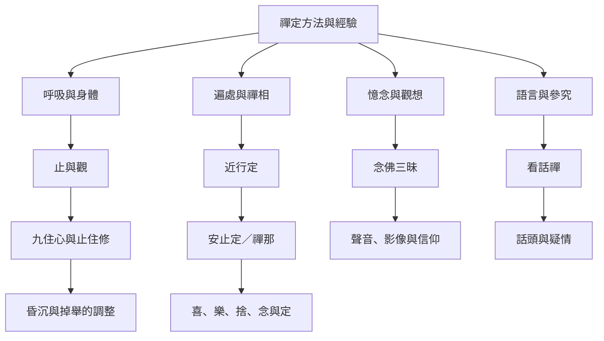

本圖整理常見的禪定所緣、方法和經驗分類，並標示上座部註釋、藏傳止住修與大乘禪觀之間的不同。方法的名稱相似，不代表其理論和目標完全相同。

## 概念連結

* [[近行定（Upacāra-samādhi）]]
* [[安止定（Appanā-samādhi）]]
* [[遍處（Kasiṇa）]]
* [[相（Nimitta）]]
* [[九住心（Nine Mental Abidings）]]
* [[念佛三昧（Buddhānusmṛti-samādhi）]]
* [[話頭（Huàtóu）]]
