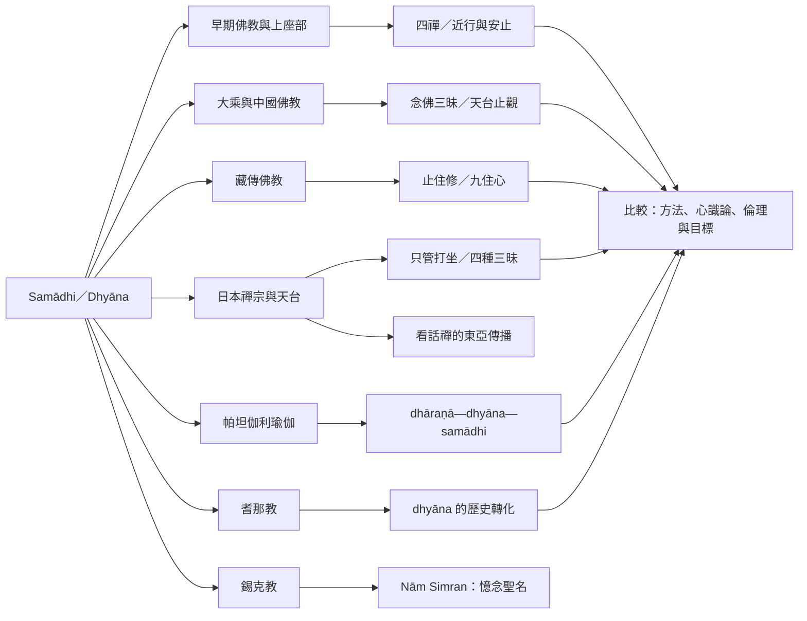

此圖把佛教不同地域與印度其他宗教的 samādhi／dhyāna 實踐並列，重點不是尋找一個放諸四海皆準的定義，而是辨識共通的穩定化技術與各傳統獨特的解脫論、儀式和身心觀。

## 概念連結

* [[《亞洲禪修傳統》提供跨印度與東亞的比較框架]]
* [[印度瑜伽與佛教的三昧必須放回各自的解脫論理解]]
* [[禪修傳統會隨經典詮釋與制度條件而改變]]
* [[Nām Simran（憶念聖名）]]
