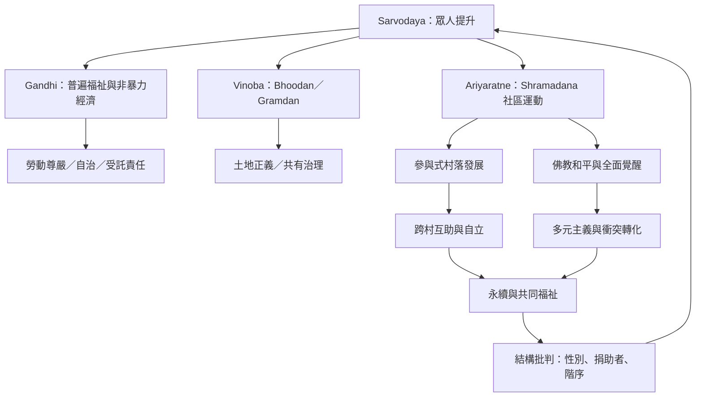

本主題可分成三個彼此交織的層次：一是 Gandhi 對普遍福祉、勞動倫理與非暴力的思想重述；二是印度 Bhoodan／Gramdan 對土地與共同財產的實驗；三是斯里蘭卡 Sarvodaya Shramadana 將佛教倫理轉為村落發展、志願勞動與和平實踐。批判研究則提醒，社區自治會受到族群權力、性別階序、組織中心化與外部資助規則影響。

核心永久筆記包括 [[note/普遍福祉不是平均分配而是確保每個人都能提升]]、[[note/社區發展應從居民共同定義問題開始]]、[[note/Shramadana 把勞動共享轉化為社區共同生產]] 與 [[note/社區自主是互賴網絡的能力而非孤立自給]]。

閱讀時可搭配 [[moc/倫理經濟與資源共有]]、[[moc/社區發展與地方自治]]、[[moc/非暴力和平與多元社會]] 及 [[moc/批判研究與組織治理]]。
