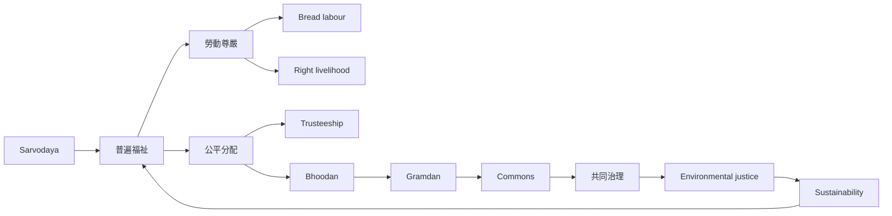

這張概念地圖聚焦 Sarvodaya 如何將共同福祉轉成勞動、財產、土地、消費與生態倫理。Gandhi 以 Ruskin 的思想提出普遍福祉與勞動尊嚴；Vinoba Bhave 透過 Bhoodan／Gramdan 將土地與村落資源納入共同治理；當代永續研究則將福祉延伸至生態系統及未來世代。

可先讀 [[note/普遍福祉不是平均分配而是確保每個人都能提升]]、[[note/無貧困無富裕是一種反消費主義的分配倫理而非美化匱乏]] 與 [[note/道德勸說無法單獨取代結構性土地改革]]。

相關概念在 [[term/Sarvodaya|Sarvodaya]]、[[term/Trusteeship|受託責任]]、[[term/Bhoodan|土地贈與]]、[[term/Gramdan|村落贈與]]、[[term/Commons|共有資源]]、[[term/Environmental justice|環境正義]] 與 [[term/Right livelihood|正命]] 之間形成互相補充的脈絡。
