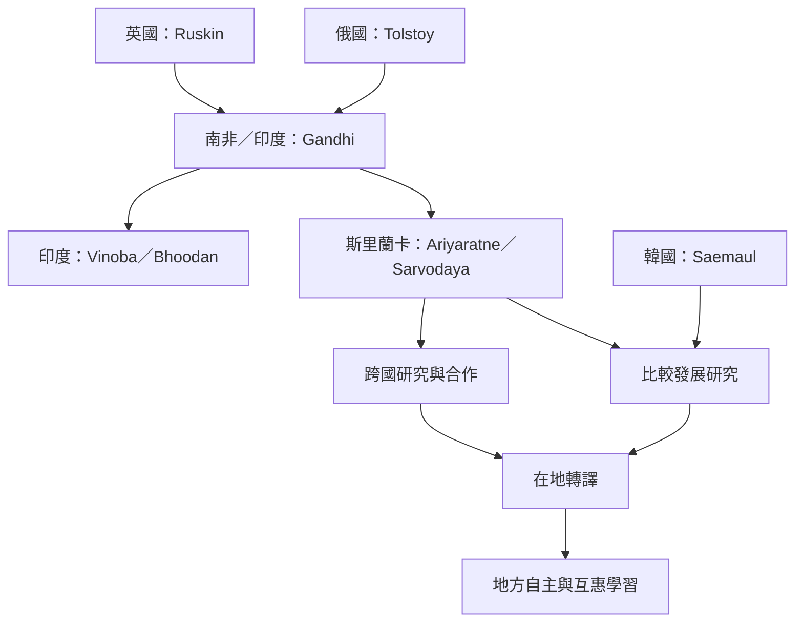

Sarvodaya 的全球脈絡不是一條單向輸出路線，而是多次轉譯：英國 Ruskin 對財富與勞動的批判、俄國 Tolstoy 的麵包勞動倫理，在南非與印度的 Gandhi 實踐中重組；Vinoba Bhave 以 Bhoodan／Gramdan 回應印度土地問題；Ariyaratne 再將 Gandhi 思想與斯里蘭卡佛教及地方社區文化連結。韓國 Saemaul 運動則提供一個比較案例，顯示社區動員可以服務不同的發展目標。

建議閱讀 [[note/Sarvodaya 的普遍理想必須經過在地轉譯而非複製]] 及 [[note/地方自治需要國家權利保障而非國家退出]]。

概念連結：[[term/Localization|在地化]]、[[term/Translocal network|跨地方網絡]]、[[term/Interdependence|互賴]]、[[term/Participatory development|參與式發展]]。
