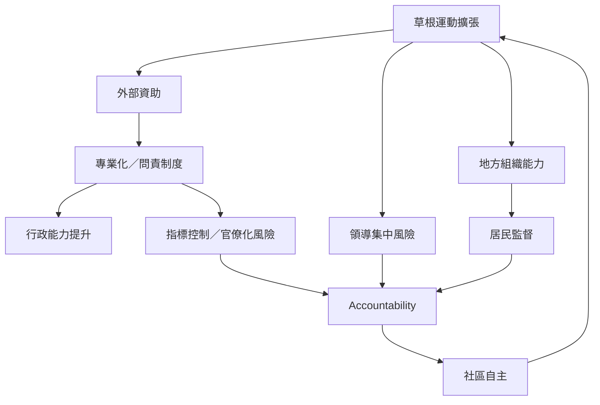

Sarvodaya 的理想與實際運作必須一起研究。組織擴大後，外部資助可能改變行政流程與決策權；專業化可能提升問責，也可能讓地方知識被邊緣化；宗教與社區動員可能促進和平，也可能再製多數主義；女性參與可能增加，但正式職位與非正式照護負擔仍需分開檢視。

建議閱讀 [[note/外部資助若壟斷指標與流程會削弱社區自主]]、[[note/專業化應增加問責能力而不是取代地方知識]]、[[note/社區互助必須檢查性別化照護與決策權]]。

概念連結：[[term/NGO|非政府組織]]、[[term/Accountability|問責]]、[[term/Gender equality|性別平等]]、[[term/Care ethics|照護倫理]]、[[term/Leadership|領導]]。
