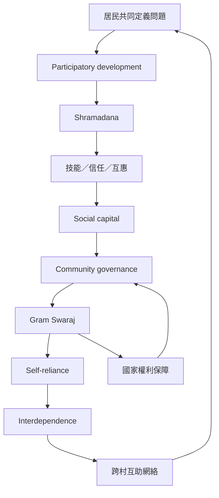

這張地圖把 Shramadana 的共同工作、參與式發展、社會資本、地方自治與跨社區網絡放在一起。Sarvodaya 的實務重點是讓居民先定義問題，再形成組織、回應基本需要、建立經濟能力，最後支持其他社區。自立因此不是孤立，而是能在互賴網絡中作出選擇與協商。

建議閱讀 [[note/社區發展應從居民共同定義問題開始]]、[[note/Shramadana 把勞動共享轉化為社區共同生產]]、[[note/社區自主是互賴網絡的能力而非孤立自給]]。

概念對照：[[term/Shramadana|Shramadana]]、[[term/Participatory development|參與式發展]]、[[term/Community development|社區發展]]、[[term/Swaraj|自治]]、[[term/Gram Swaraj|村落自治]]、[[term/Subsidiarity|輔助性原則]]、[[term/Interdependence|互賴]]。
