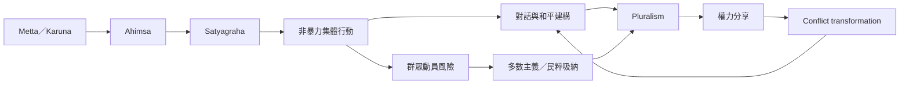

Sarvodaya 將佛教慈悲、Gandhian 非暴力與社區集體行動連結，但多元社會中的和平工作不能只依賴共同人性或善意。它需要處理歷史傷害、語言權利、族群代表性與制度不平等。包容是參與的起點，多元主義則要求差異與權力能被公開協商。

建議閱讀 [[note/包容不同於多元主義：共同行動不能抹除差異]]、[[note/非暴力動員需要處理歷史傷害與制度性不平等]]。

相關概念：[[term/Metta|慈]]、[[term/Karuna|悲]]、[[term/Ahimsa|不害]]、[[term/Satyagraha|真理力量]]、[[term/Pluralism|多元主義]]、[[term/Conflict transformation|衝突轉化]]、[[term/Nonviolent resistance|非暴力抵抗]]。
