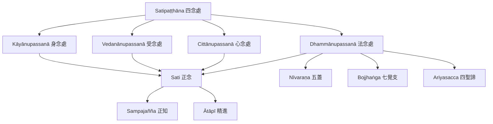

四念處由身、受、心、法四個觀察領域構成，並以精進、正知、正念及放下貪憂作為共同修習條件。這張地圖從原典架構延伸到身心現象、障礙與覺醒因素。

延伸閱讀：[[Satipaṭṭhāna]]、[[Kāyānupassanā]]、[[Vedanānupassanā]]、[[Cittānupassanā]]、[[Dhammānupassanā]]、[[Sampajañña]]、[[Ātāpī]]、[[Nīvaraṇa]]、[[Bojjhaṅga]]、[[Ariyasacca]]。

核心永久筆記：[[四念處是一套連結觀察對象與解脫方向的完整訓練]]、[[四念處可視為相互照明的觀察領域而非僵硬的四階段]]。
