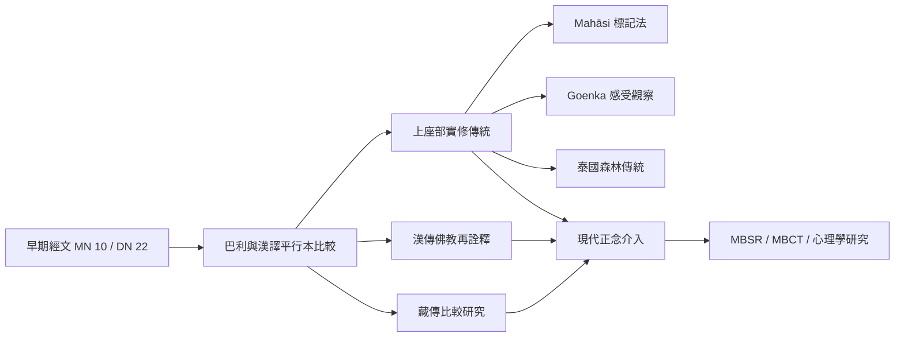

四念處在巴利傳承、漢譯阿含、緬甸內觀、泰國森林傳統、藏傳詮釋與當代心理學中，形成不同的文本保存、實修安排及公共用途。跨傳承比較需要同時辨識共同架構和具體差異。

延伸閱讀：[[Āgama]]、[[Satipaṭṭhāna]]、[[MBSR]]、[[MBCT]]、[[Vipassanā]]、[[Sati]]。

核心永久筆記：[[跨傳本研究能同時尊重共同核心與傳承差異]]、[[不同禪修傳承是對共同修道問題的不同教學回應]]、[[現代正念是跨傳統重組後的當代實踐]]。
