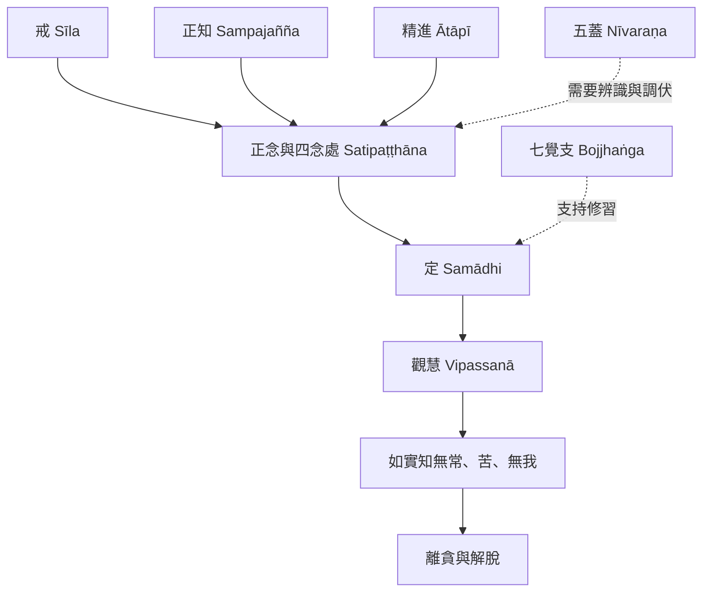

四念處是八正道中的正念修習，也需要戒行作為基礎，並與定及智慧共同運作。這張圖把四念處放回完整修道脈絡，避免將它簡化成單一注意力技術。

延伸閱讀：[[Sīla]]、[[Satipaṭṭhāna]]、[[Samādhi]]、[[Vipassanā]]、[[Anicca]]、[[Dukkha]]、[[Anattā]]、[[Sampajañña]]、[[Ātāpī]]。

核心永久筆記：[[四念處需放回戒定慧與八正道的整體脈絡]]、[[精進正知正念共同構成四念處的實踐品質]]。
