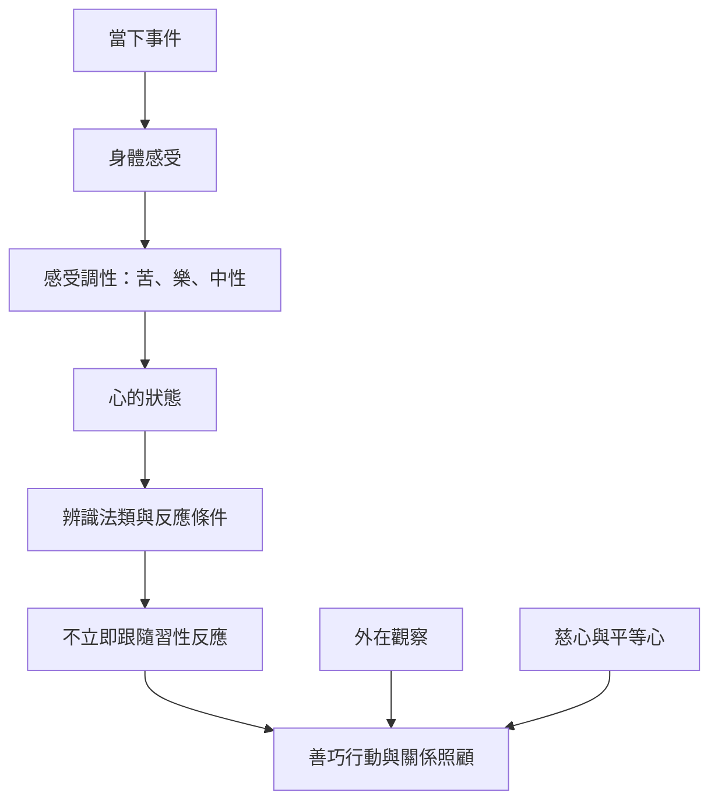

四念處不只適用於個人靜坐。身體觀察、感受調性與心態辨識可以延伸到走路、飲食與人際互動；外在念處研究則提醒，觀察他人必須避免把推測當成事實。

延伸閱讀：[[Vedanā]]、[[Upekkhā]]、[[Taṇhā]]、[[Cittānupassanā]]、[[Kāyānupassanā]]、[[Sampajañña]]。

核心永久筆記：[[外在念處使正念從個人內觀延伸到關係倫理]]、[[受念處辨識感受調性而不立即跟隨反應]]、[[身念處讓身體成為觀察經驗而非認同自我的入口]]。
