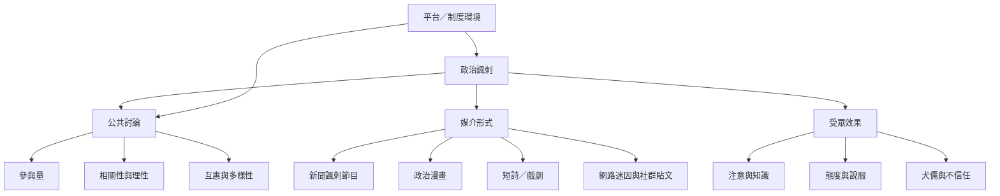

本圖聚焦政治諷刺如何經由不同媒介進入公共討論，以及「參與」與「討論品質」之間的差異。

延伸：[[政治諷刺的說服力並不必然高於嚴肅新聞]]、[[諷刺新聞能增加部分政治知識卻也可能提高犬儒與不信任]]、[[線上諷刺討論的民主品質要看回應內容而不只是留言數]]、[[中國網路案例提醒諷刺可能削弱討論的理性與互惠]]、[[諷刺可以在審查縫隙中維持有限的異議空間]]。

本書脈絡：[[Satire]]。
