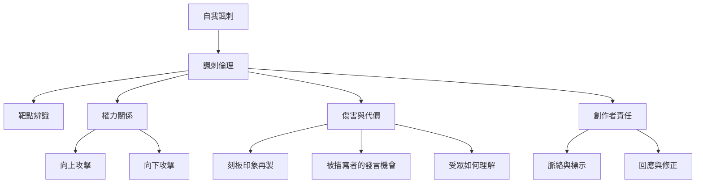

諷刺的倫理評估需要同時看批判靶點、權力關係、受眾與實際代價。本圖將「向上／向下」視為必要線索之一，而非一條可以取代脈絡分析的簡單規則。

延伸：[[諷刺的倫理要檢查笑聲指向誰以及代價由誰承擔]]、[[冒犯性喜劇的倫理不能簡化成是否向下攻擊]]、[[批判權威不等於嘲笑信仰者]]、[[自我諷刺能降低批判者佔據道德高地的風險]]、[[設計諷刺作品前先畫出權力關係而不是先找笑點]]。

本書脈絡：[[Satire]]。
