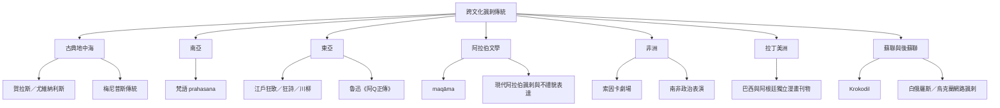

本圖把諷刺放入不同地區的本土形式中，不以單一歐洲文類分類統攝全球材料。連結是比較入口，不代表各形式完全等同。

延伸：[[七世紀印度梵語獨幕喜劇以宗教角色諷刺社會現象]]、[[江戶時代的狂歌狂詩與川柳展現日本諷刺詩的多樣形式]]、[[魯迅以阿Q的精神勝利法諷刺自我合理化與歷史秩序]]、[[阿拉伯古典 مقامه 以機智騙徒敘事結合語言遊戲與社會觀察]]、[[沃萊·索因卡以宗教騙術劇諷刺社會權威與腐敗]]、[[巴西與阿根廷軍政府時期的政治漫畫創造了批判空間]]、[[蘇聯諷刺刊物能同時重述官方意識形態並暴露其矛盾]]。

本書脈絡：[[Satire]]。
