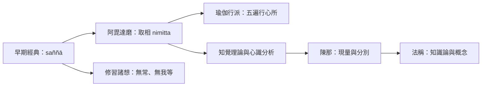

Saṃjñā 的思想史不能只用一條線性發展描述。早期經典用辨認顏色與觀察五蘊無常說明 saññā；阿毘達磨把想定義為取相；瑜伽行派將其列入遍行心所；佛教量論則從有效知識問題討論現量與概念分別。這些是彼此交疊但不完全相同的理論問題。

進一步閱讀：[[《相應部 22.79》以色彩辨認說明想蘊的特徵作用]]、[[《增支部 10.60》把無常與無我等觀法稱為想]]、[[《俱舍論》以取青黃長短等相界定想蘊]]、[[印度佛教量論區分直接知覺與概念分別]]、[[佛教無分別知覺論與想蘊分類不能直接等同]]、[[跨語翻譯需保留想蘊概念的歷史差異]]。

## 思與行
* 讀每一個理論時先標註年代、語言、宗派與所回答的問題，再比較共通詞彙。
* 將「想蘊」「現量」「分別」「戲論」保留為不同詞條，避免過早合併。

全書導讀：[[Saṃjñā]]。
