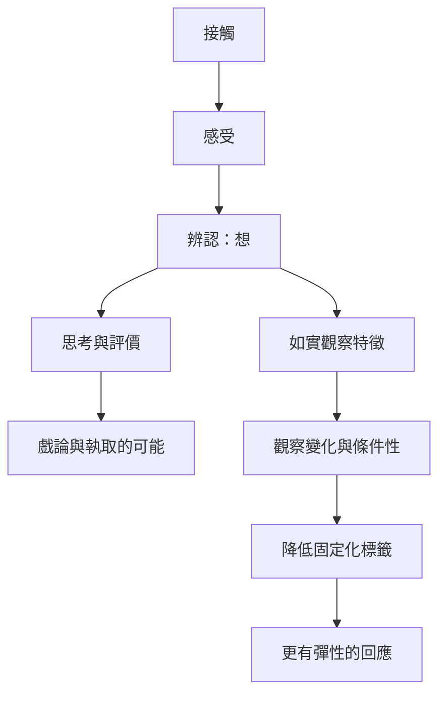

想蘊的實踐意義在於看見辨認既有助於行動，也可能和記憶、評價及自我故事相連。早期經典指出感受、辨認、思考與戲論之間的關係，另以無常想、無我想等提供修習方向。日常應用可以延伸到情緒覺察、非暴力溝通、跨文化對話與知識管理。

進一步閱讀：[[《蜜丸經》揭示辨認如何接續為概念戲論]]、[[想蘊可被觀察為無常而非自我]]、[[修習想的觀法是在重新校準注意與評價]]、[[將人固定化為標籤會把辨識轉成社會執取]]、[[觀察辨認之前後可以拆開感官特徵與推論]]、[[把人際評語改寫成可觀察行為能減少標籤傷害]]。

## 思與行
* 選一段日常互動，記錄接觸、感受、辨認、故事與行動，找出可插入覺察的地方。
* 將練習帶入群體互動，讓分類可被修正、讓被分類者有說明的機會。

全書導讀：[[Saṃjñā]]。
