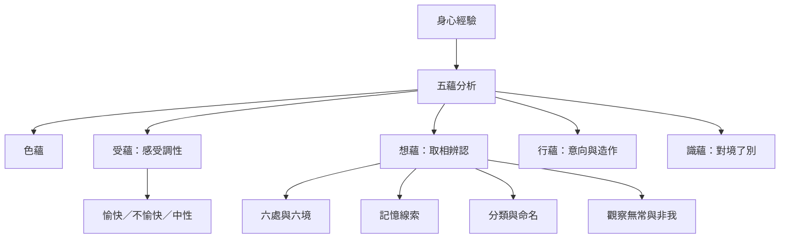

想蘊必須放回五蘊及心所系統中理解。它具有取相、辨認的功能，與受、行、識並非互斥，而是在經驗中共同發生。這張概念地圖整理早期佛典、阿毘達磨與瑜伽行派對想的定位。

進一步閱讀：[[想蘊是對境取相與辨識而不等於完整思想]]、[[想蘊在五蘊中與受行識共同構成一次心識經驗]]、[[受蘊標示感受調性而想蘊標示對境特徵]]、[[想的六種感官範圍包含意識對象]]、[[想的辨識功能使記憶能以特徵線索重認對象]]、[[瑜伽行派把想列為五遍行心所之一]]。

## 思與行
* 用同一個生活事件練習標出五蘊面向，觀察它們如何互相關聯，而非硬切成五個時間階段。
* 比較南傳阿毘達磨與瑜伽行派系統，將共同點與差異分別記錄。

全書導讀：[[Saṃjñā]]。
