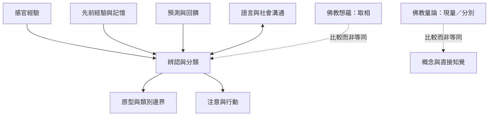

當代認知科學可從預測處理、分類知覺、原型、語言相對論及注意訓練等角度，與想蘊的取相辨認功能形成對話。比較的目的不是證明佛教或神經科學其中一方，而是更準確地辨認兩種知識傳統提出的問題與證據。

進一步閱讀：[[預測與回饋可能在知覺早期就參與分類]]、[[語言塑造知覺但不會任意創造全部知覺]]、[[原型與基本層級說明分類不是簡單二分]]、[[想蘊的認相功能不應被簡化為語言命名]]、[[當代認知科學可作為比較視角而非佛學證明]]。

## 思與行
* 設計跨文化分類小實驗時，同時測量命名、辨別與記憶，不把一種任務的結果推廣到全部知覺。
* 每次跨學科類比都註明「相似之處、差異、尚待驗證」。

全書導讀：[[Saṃjñā]]。
