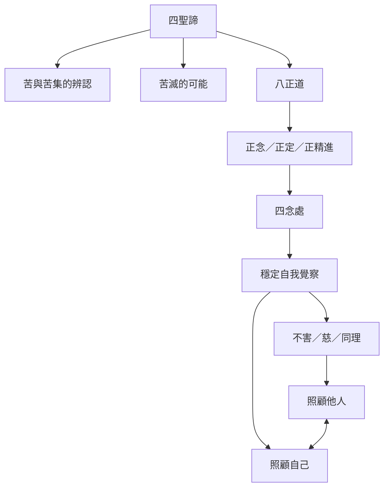

本圖把四聖諦、八正道、四念處與 SN 47.19 的互助譬喻放在同一張地圖。正念修習不只是內在技巧；經文也將其與忍耐、不害、慈和同情連起來。此處的關係倫理是對經文的實踐性閱讀，不宜將它簡化成自我照顧即能取代社會支持。

主要筆記：[[四聖諦把問題診斷與修行路徑連成一個可操作架構]]、[[正念照顧自己與不害他人是互相支持的兩種責任]]、[[比丘尼相應保留女性修行者的論辯主體性]]。

延伸實踐：[[把日常刺激記錄成六處與受的微型觀察實驗]]、[[以竹竿雜技譬喻設計團體互助的安全界線]]、[[讓比丘尼相應成為共學中的多聲道閱讀練習]]。

概念入口：[[四念處]]、[[四聖諦]]、[[八正道]]。
