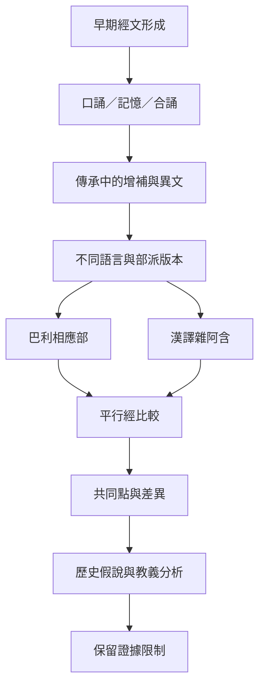

研究相應部時，可區分三個互補問題：經典如何以口誦形式形成與傳遞；不同部派／語言如何保存平行經；現代學者如何利用版本差異提出歷史判斷。三者不能互相取代。口傳研究不等於證明某一經文為真或為假，平行經研究也不必然能復原唯一原始文本。

主要文獻：[[Mark Allon指出早期佛教經文是為口誦記憶而塑形的文學文本]]、[[Anālayo以來源監控問題討論早期佛典口傳的增補可能]]、[[法鼓文理學院的雜阿含經研究連結巴利與漢譯平行經]]、[[Choong以跨傳承比較檢視相應部中的人物與主題群]]、[[相應部的相應群比較能揭示共同教義與不同傳承的編排差異]]。

概念入口：[[口傳傳承]]、[[平行經]]。
