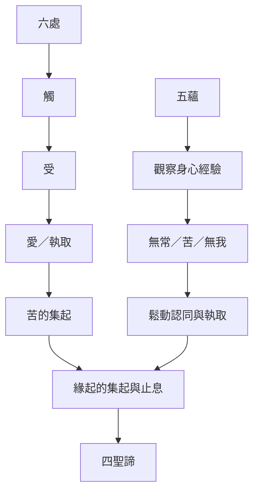

相應部的教法可沿著緣起、五蘊、六處、受與無我互相連結。這些不是彼此孤立的學說：六處說明接觸如何發生，受標示經驗的感受調性，緣起指出條件如何支持苦的集起，五蘊提供身心經驗的分析架構，無我則檢視其中是否存在可完全主宰的恆常自我。

主要筆記：[[緣起同時說明苦的形成與止息]]、[[五蘊觀察將無我從形上主張轉成可檢驗的經驗問題]]、[[六處經驗界定可討論的一切並凸顯感官接觸]]、[[正見避免把存在與不存在當成固定答案]]、[[感受與第二支箭的差異指出苦可在反應中增長]]。

概念入口：[[緣起]]、[[五蘊]]、[[六處]]、[[受]]、[[無我]]、[[四聖諦]]。
