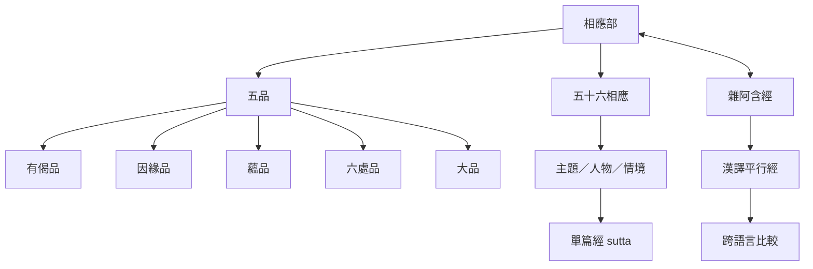

本圖整理相應部如何由五品、五十六相應與單篇經文構成，以及巴利本與漢譯《雜阿含經》的比較入口。主題式結集使相應部適合沿著同一教法進行多經對讀；但版本比較仍須注意經文分段、分類和譯語差異。

主要筆記：[[相應部的五品五十六相應構成主題式經藏]]、[[依主題編排使相應部適合比較同一教法的不同切面]]、[[五品的順序提供從人物詩偈到修道結構的閱讀路線]]、[[雜阿含經提供相應部的重要平行材料]]、[[平行經比較能辨識共同核心與傳承差異]]。

概念入口：[[相應部]]、[[相應]]、[[五品]]、[[經]]、[[雜阿含經]]、[[平行經]]。
