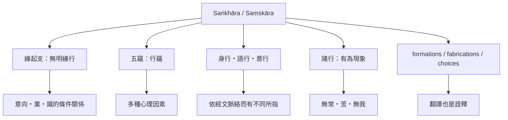

saṅkhāra 的多義性可以整理成四個主要語境：緣起支的造作、五蘊中的行蘊、禪定分析中的身語意行，以及「諸行無常」中的有為現象。它們共享造作與條件形成的語意家族，但不應被壓縮成同一個狹義定義。

延伸連結：[[Saṅkhāra（巴利語行）]]、[[Saṃskāra（梵語行）]]、[[行蘊]]、[[緣起]]、[[有為法]]、[[諸行無常與諸法無我具有不同的論述範圍]]、[[行必須依照經文位置辨義而不能固定翻譯]]。
