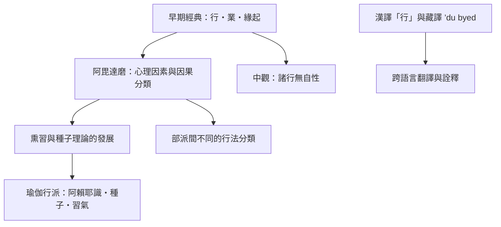

早期經典中的行、阿毘達磨的心理因素分類、瑜伽行派的熏習與種子、中觀的無自性分析，分別回應造作、因果連續性、心識構成與存在依存等問題。它們有思想史上的關聯，但不是單一路徑上的同義詞替換。

延伸連結：[[阿毘達磨]]、[[瑜伽行派]]、[[阿賴耶識（ālayavijñāna）]]、[[習氣（vāsanā）]]、[[種子（bīja）]]、[[空性（śūnyatā）]]、[[不同部派的分類系統不能互相直接代換]]、[[佛教思想史中的相似術語不必然代表同一理論]]。
