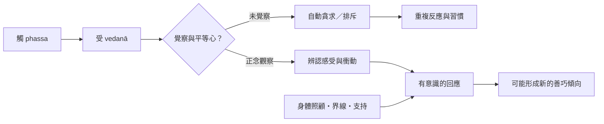

內觀修習可以從感受與反應之間的空間切入：先覺察觸與受，再辨認渴愛、排斥或慣性意向，並培養不立即反應的平等心。這是可操作的修習地圖，但各傳承對 saṅkhāra 的理論解釋並不完全相同。

延伸連結：[[受（vedanā）]]、[[愛（taṇhā）]]、[[平等心（upekkhā）]]、[[正念（sati）]]、[[習氣（vāsanā）]]、[[平等心讓感受不必自動轉成新的反應]]、[[每天記錄一次身語意反應能讓造作過程變得可見]]。
