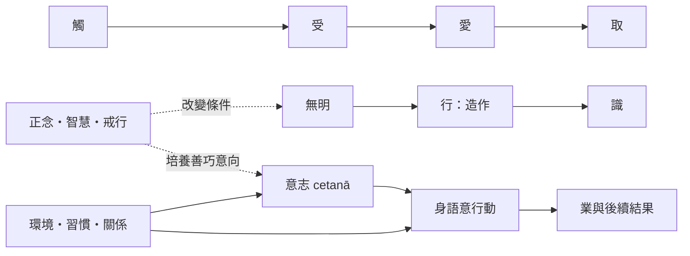

在緣起與業論的語境中，行不是孤立意志的命令，而是無明、接觸、意向、身語意行動及其後續結果所形成的條件過程。修行可在因果鏈中培養覺察與善巧意向，但不因此否定既有條件的影響。

延伸連結：[[緣起]]、[[無明（avijjā）]]、[[意志（cetanā）]]、[[業（kamma）]]、[[受（vedanā）]]、[[愛（taṇhā）]]、[[取（upādāna）]]、[[意志是業的關鍵條件但不是孤立自我的命令]]、[[改變習慣需要調整條件而不只是要求意志力]]。
