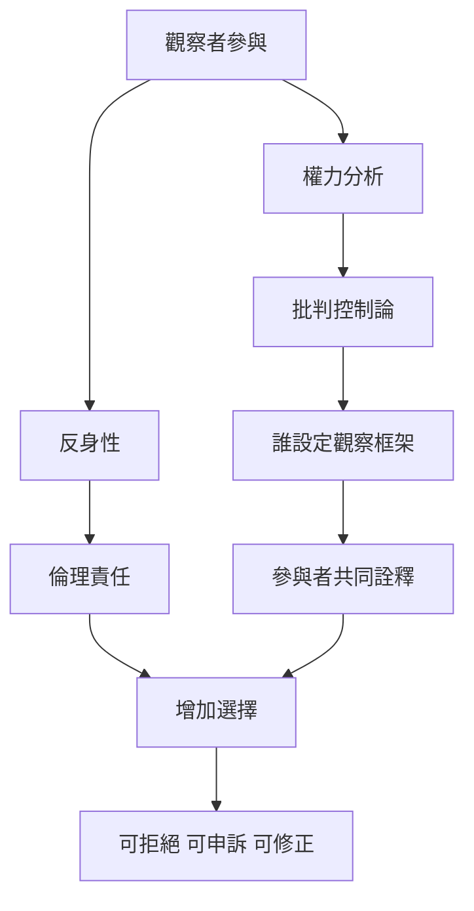

觀察者參與帶來責任，但只要求研究者自我反思仍不足以處理權力不對等。批判控制論會繼續追問誰能設定區分、控制資料與定義問題；倫理評估則檢查不同群體是否真正擁有理解、拒絕、申訴與共同決策的能力。

**概念連結：** [[二階控制論]]、[[觀察者]]、[[反身性]]、[[批判控制論]]、[[區分]]、[[觀察盲點]]。

**延伸閱讀：** [[控制論倫理要求增加選擇並承擔參與責任]]、[[批判控制論必須追問誰有權設定觀察區分]]、[[二階觀察不能取代受影響者對自身處境的詮釋]]。
