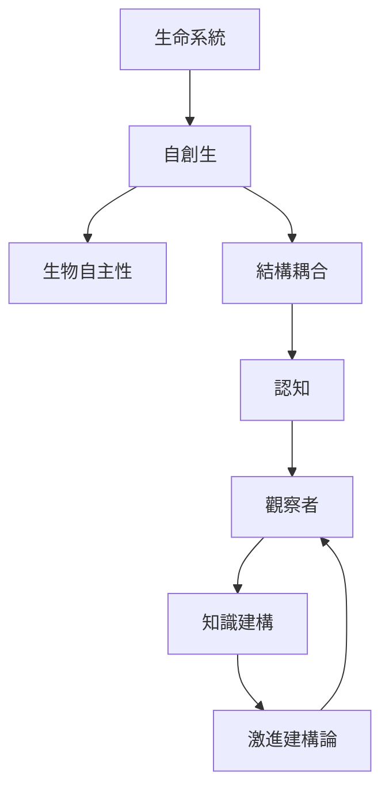

Maturana 與 Varela 的生命理論把認知放回生命系統的組織與活動。自創生描述生命如何維持自身組織，結構耦合描述系統在持續互動中的相互變化，生物自主性則強調生命系統的自我維持與行動條件。這些概念與第二序控制論的觀察者問題相接，但彼此並非同義詞。

**概念連結：** [[自創生]]、[[結構耦合]]、[[認知]]、[[生物自主性]]、[[觀察者]]、[[激進建構論]]、[[二階控制論]]。

**延伸閱讀：** [[自創生系統以自身組織決定可承受的擾動]]、[[結構耦合讓系統在互動中相互改變但不直接指令對方]]、[[知識是認知者在經驗中建構而非被動複製]]。
