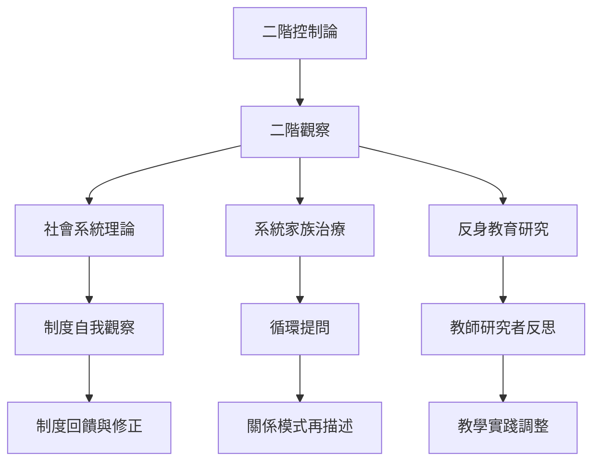

二階觀察進入社會領域後，可以分析制度如何使用分類與指標觀察自身，也可以分析治療者、教師與研究者如何參與自己正在觀察的互動。Luhmann 的社會系統理論、米蘭系統家族治療與反身教育研究，構成三個彼此可比較但不能互相化約的應用場域。

**概念連結：** [[二階觀察]]、[[反身性]]、[[對話理論]]、[[觀察盲點]]、[[區分]]。

**延伸閱讀：** [[治療者的提問會改變其所研究的關係系統]]、[[制度的自我觀察會重塑制度可見的問題]]、[[二階觀察不能取代受影響者對自身處境的詮釋]]。
