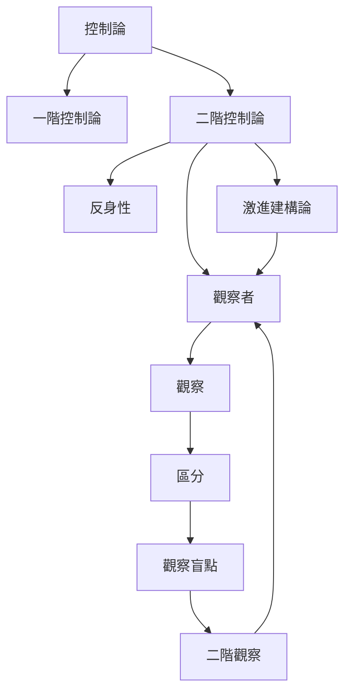

第二序控制論的主幹是觀察者轉向：觀察不是透明地複製世界，而是透過區分、工具與目的形成描述。觀察者可以再觀察自己的觀察，但每一次反身操作仍會產生新的盲點。此圖串連一階／二階控制論、觀察、區分、盲點、反身性與建構論。

**概念連結：** [[控制論]]、[[一階控制論]]、[[二階控制論]]、[[觀察者]]、[[觀察]]、[[區分]]、[[二階觀察]]、[[觀察盲點]]、[[反身性]]、[[激進建構論]]、[[自我指涉]]。

**延伸閱讀：** [[觀察者不是系統外的中立攝影機]]、[[二階觀察能比較觀察方式但不能消除盲點]]、[[每次觀察都以區分選擇顯著與被排除之物]]。
