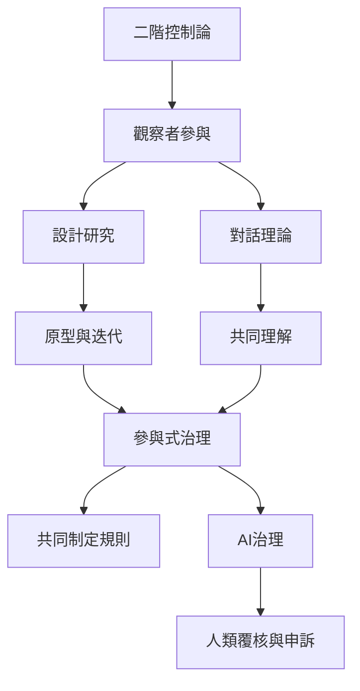

第二序控制論將設計理解為觀察者參與的建構活動；Pask 的對話理論則說明學習與理解如何在互動中協調。兩者可以延伸到參與式治理與 AI 介面設計：制度或技術的使用者不只是被觀察的對象，也應參與定義問題、評估後果與修正規則。

**概念連結：** [[二階控制論]]、[[觀察者]]、[[對話理論]]、[[反身性]]、[[批判控制論]]、[[控制論倫理要求增加選擇並承擔參與責任]]。

**延伸閱讀：** [[設計活動可視為在不確定中進行的對話式建構]]、[[建立能讓社群修改自身規則的參與式治理迴路]]、[[讓AI使用者能檢視並修正系統提供的觀察框架]]。
