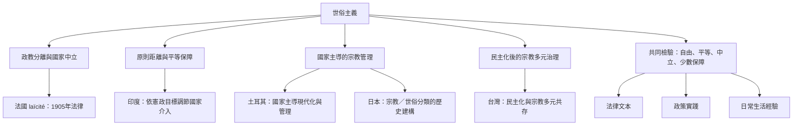

世俗主義是多種制度安排的集合，不宜把任何一個國家模式當作全球標準。比較時可同時檢查國家中立、政教分離、宗教自由、國家介入程度、公共宗教活動與少數保障。

## 連結
* [[世俗主義是治理宗教多元的政治原則]]、[[世俗主義不存在單一可移植的制度模板]]。
* [[法國1905年政教分離法確立共和國宗教中立原則]]、[[印度世俗主義以原則距離回應宗教多元但本身持續爭議]]。
* [[土耳其世俗主義是國家主導的現代化工程並非單純政教分離]]、[[日本近代宗教分類將神道放在宗教與世俗邊界之外]]。
* [[中國與台灣呈現不同的世俗國家與宗教治理組合]]。
* [[用一張比較矩陣辨認各國世俗主義的不同制度邏輯]]。
