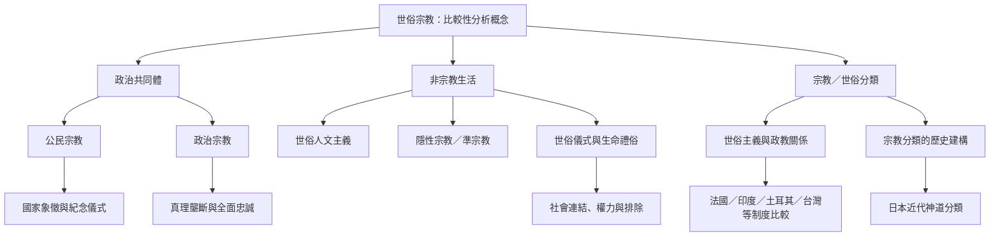

本圖把「世俗宗教」拆成三條互相關聯但不能混同的研究路徑：政治共同體的神聖化、非宗教生活中的儀式與意義，以及國家如何劃定宗教／世俗邊界。跨文化研究應同時觀察制度與日常生活，並把分類權力納入分析。

## 連結
* 核心分析：[[世俗宗教是多種世俗生活中宗教性功能的比較性概念]]、[[比較世俗宗教必須區分信念歸屬與實踐]]。
* 政治路徑：[[公民宗教把國家共同體儀式化]]、[[政治宗教將政治秩序提升為終極信仰]]。
* 生活路徑：[[無宗教身份不等於缺乏意義與社群]]、[[世俗人文主義可以提供倫理與儀式社群]]、[[儀式不需要超自然信仰也能創造社會連結]]。
* 分類路徑：[[宗教與世俗的邊界是歷史建構而非自然事實]]、[[世俗主義是治理宗教多元的政治原則]]。
* 靈感延伸：[[建立不要求世界觀一致的世俗共學與互助社群]]、[[把台灣公共紀念設計成容納多重記憶的公民儀式]]。
