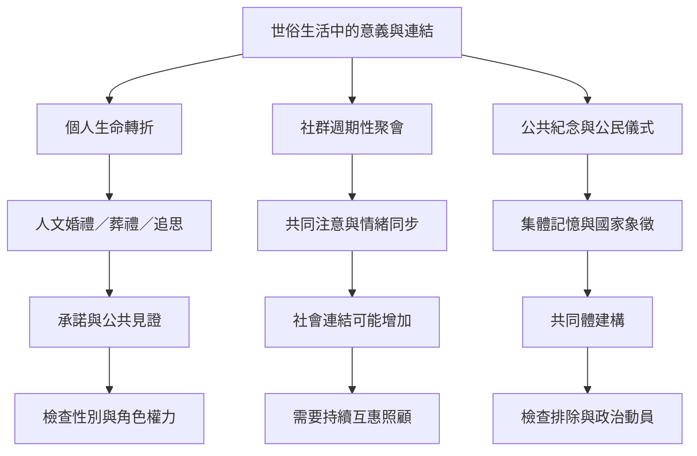

世俗社會並不缺少儀式；生命禮俗、公共紀念、社群聚會與共同活動都可能創造連結與意義。關鍵在於儀式如何被共同創作、誰能參與，以及象徵性承諾如何延伸為日常照顧。

## 連結
* [[儀式不需要超自然信仰也能創造社會連結]]、[[人文儀式能讓生命轉折有公共見證而不必依賴超自然信念]]。
* [[世俗人文主義可以提供倫理與儀式社群]]、[[群體儀式不能取代持續的互惠照顧]]。
* [[世俗儀式能提升社會連結但研究樣本與情境有限]]、[[非宗教聚會可以提供歸屬感但也可能伴隨群體中的孤獨]]。
* [[世俗儀式也可能重製社會權力關係]]、[[集體凝聚力同時包含排除與權力]]。
* [[為生命轉折共同創作可修改的人文儀式]]、[[讓世俗社群的儀式從情緒高峰延伸到日常照顧]]。
