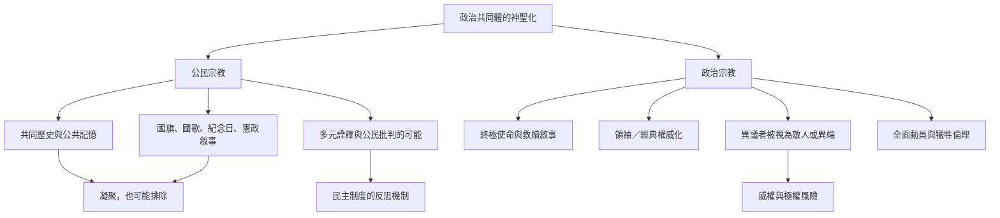

兩者都關注政治共同體如何獲得神聖或終極意義，但分析重點不同。公民宗教可能在多元民主制度中形成共同記憶；政治宗教則特別關注政治權力如何壟斷真理、要求全面忠誠並懲罰異議。實際案例可能呈現混合型態，應依具體制度與實踐判斷。

## 連結
* [[公民宗教把國家共同體儀式化]]、[[政治宗教將政治秩序提升為終極信仰]]。
* [[神聖化可以發生在民族與公共象徵]]、[[集體凝聚力同時包含排除與權力]]。
* [[美國公民宗教透過國家敘事與儀式建立超越教派的公共信仰]]、[[韓國公民宗教在國家建構中動員國旗國歌與經濟成長敘事]]。
* [[設計公共儀式時加入反思與退出機制]]。
