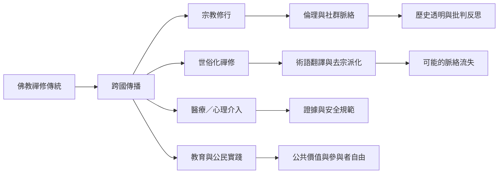

佛教禪修在全球流動時，會被不同制度與參與者理解為宗教修行、身心訓練、健康介入、教育活動或倫理生活。關鍵不是替它選定唯一身份，而是追蹤翻譯過程、傳承脈絡與制度效果。

主線：[[Meditation_Can_Cross_Religious_and_Secular_Categories_Without_Losing_History]]、[[Public_Education_Can_Be_Nonsectarian_Without_Being_Value_Empty]]。

資料來源：[[David_McMahan_Buddhism_Meditation_and_Global_Secularisms_2017]]、[[Usha_Modak_Secularism_and_Vipassana]]、[[Talal_Asad_Formations_of_the_Secular_2003]]。

可行研究：[[Interview_Practitioners_About_How_They_Translate_Religion_and_Secularism]]、[[Create_a_Nonsectarian_Meditation_Course_Description_With_Transparent_Lineage]]。
