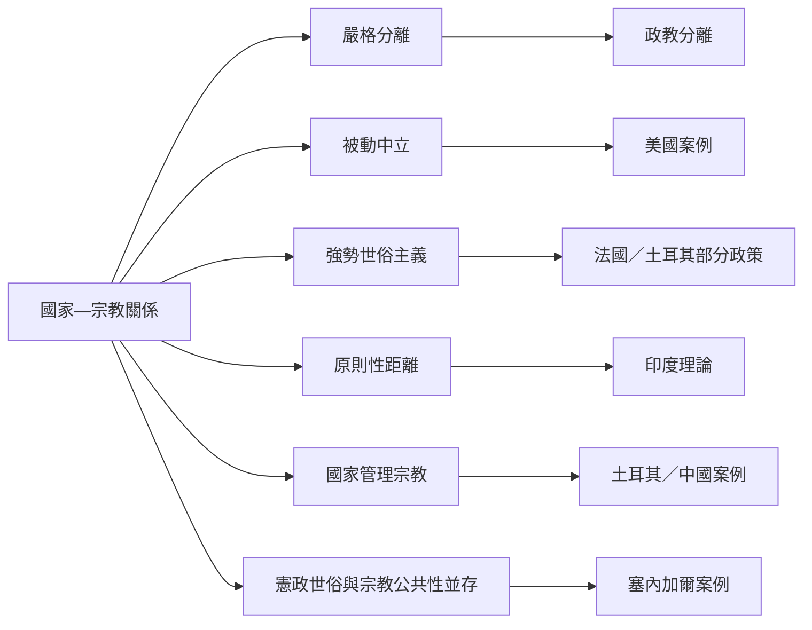

這張地圖比較世俗主義的制度模型。模型是分析工具而非國家永久標籤；同一國家也可能在不同時期、政策領域與地方層級呈現混合形式。

閱讀主軸：[[Secularism_Is_Not_A_Single_Institutional_Model]]、[[State_Neutrality_Does_Not_Require_Mechanical_Equal_Distance_From_All_Religions]]、[[The_Principled_Distance_Model_Treats_Equality_As_Contextual_Judgment]]。

區域材料：[[France_Laicite_Official_Explanation]]、[[United_States_First_Amendment_Religion]]、[[India_Constitution_and_Secularism]]、[[Turkey_Laiklik_and_State_Management_of_Religion]]、[[Senegal_Laicite_and_Sufi_Public_Life]]、[[Indonesia_Pancasila_and_Religious_Citizenship]]。
