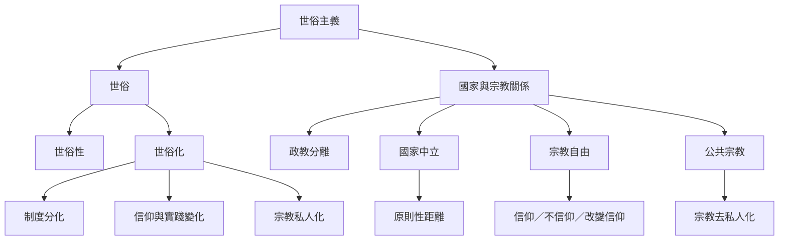

這張概念地圖先區分核心術語，再呈現制度分化、宗教自由、國家中立與公共宗教之間的互動。閱讀時要避免把描述性的世俗化理論直接當成規範性的世俗主義主張。

核心閱讀：[[Secular_Secularity_Secularization_and_Secularism_Are_Different_Analytical_Levels]]、[[Secularization_Does_Not_Mean_Religious_Belief_Must_Decline]]、[[Religious_Freedom_Includes_Belief_Nonbelief_and_Changing_Belief]]、[[State_Neutrality_Does_Not_Require_Mechanical_Equal_Distance_From_All_Religions]]。

延伸概念：[[世俗主義]]、[[Secularity]]、[[Secularization]]、[[The_Secular]]、[[Freedom_of_Religion_or_Belief]]、[[Public_Religion]]、[[Deprivatization_of_Religion]]、[[Institutional_Differentiation]]、[[Postsecularism]]。
