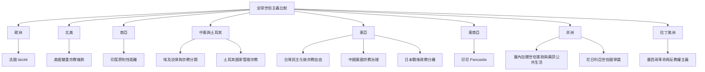

全球比較不宜採用「由宗教走向世俗」的單一路徑。這張地圖以歷史脈絡、憲政安排與宗教社會生活為比較軸線。

比較原則：[[世俗主義需要以地方歷史脈絡理解]]、[[Secularism_Is_Not_A_Single_Institutional_Model]]、[[Secularization_Does_Not_Mean_Religious_Belief_Must_Decline]]。

區域文獻：[[Charles_Taylor_Problems_around_the_Secular_2007]]、[[France_Laicite_Official_Explanation]]、[[United_States_First_Amendment_Religion]]、[[India_Constitution_and_Secularism]]、[[Turkey_Laiklik_and_State_Management_of_Religion]]、[[Hussein_Agrama_Secularism_Sovereignty_Indeterminacy_2010]]、[[Taiwan_Religious_Freedom_and_Neosacred_State]]、[[Japan_Postwar_Secularism_and_State_Shinto]]、[[China_Religious_Regulation_and_Party_State]]、[[Indonesia_Pancasila_and_Religious_Citizenship]]、[[Senegal_Laicite_and_Sufi_Public_Life]]、[[Nigeria_Quest_for_a_Secular_State_2025]]、[[Mexico_Anticlericalism_and_Secular_State_Building]]。
