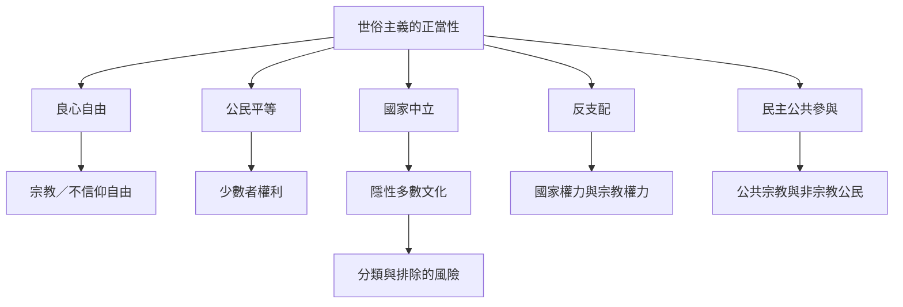

世俗主義的規範爭論圍繞幾個相互牽制的價值：良心自由、平等、公民共同性、宗教自由、國家中立、少數者保護與反支配。批判理論提醒，制度也會製造分類與排除；規範理論則要求保留可限制國家與宗教權力的共同原則。

主線筆記：[[Secularism_Must_Be_Judged_By_Freedom_Equality_and_Non_Domination]]、[[The_State_Is_Not_A_Neutral_Observer_Outside_Religion]]、[[Secular_Categories_Can_Reshape_Religious_Identity]]、[[Deep_Pluralism_Must_Address_Emotion_and_Everyday_Practices]]。

文獻對照：[[Talal_Asad_Formations_of_the_Secular_2003]]、[[Saba_Mahmood_Religious_Difference_in_a_Secular_Age_2015]]、[[William_Connolly_Some_Theses_on_Secularism_2011]]、[[Ashis_Nandy_Politics_of_Secularism_1990]]、[[Rajeev_Bhargava_Reimagining_Secularism_2019]]。
