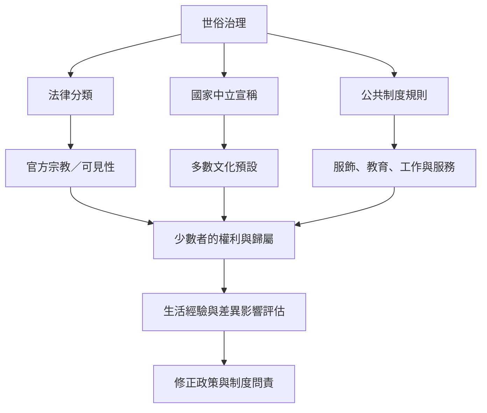

世俗主義既是自由與平等的制度承諾，也可能透過法律分類、國家管理、殖民歷史與文化預設產生排除。批判不必否定世俗原則，而是檢查原則在日常生活中如何被執行、由誰承擔成本。

概念：[[世俗治理]]、[[殖民世俗主義]]、[[交織性]]、[[國家中立]]、[[宗教多元]]。

研究筆記：[[世俗不是宗教退場後的中性空間而有其歷史系譜]]、[[法國穆斯林的世俗經驗受到性別種族化與公民身份交織影響]]、[[世俗治理可能在承諾平等時重製宗教少數的不平等]]。

行動方向：[[以台灣日常公共服務測試良心自由是否真正中立]]、[[把宗教服飾政策改用必要性與差異影響檢核]]、[[以生活經驗補足憲法條文的比較研究]]。
