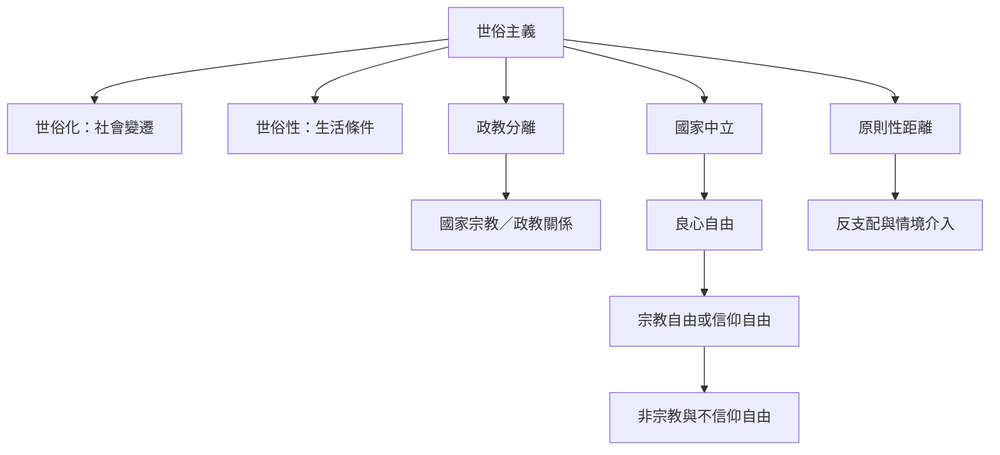

世俗主義的概念核心是國家如何處理宗教權威、個人良心、公共參與和公民平等。先區分政治原則（世俗主義）、社會變遷（世俗化）與生活條件（世俗性），再理解政教分離、國家中立與原則性距離只是不同制度工具。

核心概念：[[世俗主義]]、[[世俗性]]、[[世俗化]]、[[政教分離]]、[[國家中立]]、[[原則性距離]]、[[良心自由]]、[[宗教自由或信仰自由]]、[[非宗教]]、[[世俗治理]]、[[多元世俗主義]]。

永久論點：[[世俗主義的核心是平等公民地位而非單一制度形式]]、[[世俗化不是必然朝無宗教社會直線前進]]、[[政教分離是不同制度選擇而不是單一可複製模型]]。
